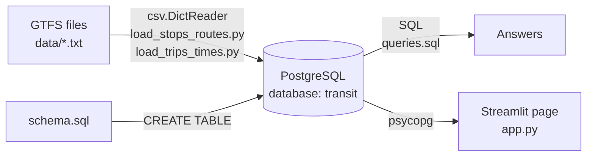
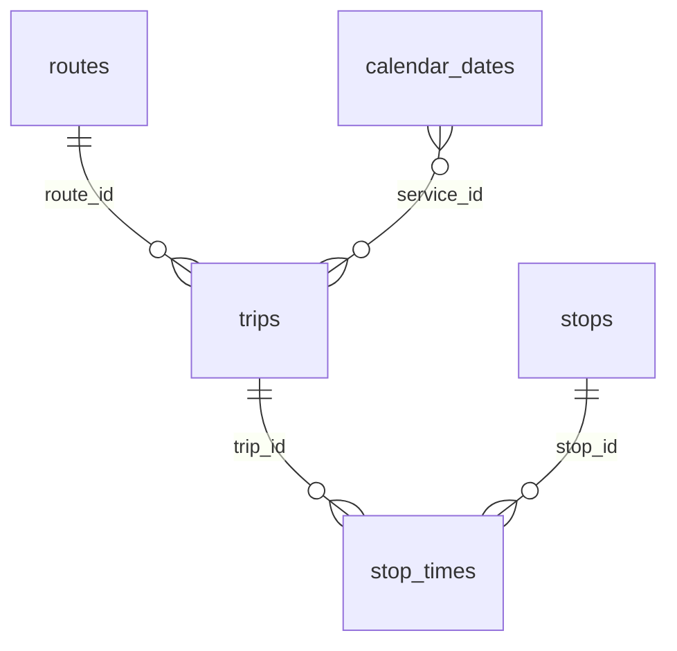

# GTA Transit Tracker (GO Transit)

A data engineering project that loads the GO Transit schedule into PostgreSQL, answers real questions about it with SQL, and shows the answers on a Streamlit web page.

This is Phase 1: the published (static) schedule. Tracking real-time delays and reliability across the GTA is planned for a later phase.

## Architecture



1. **Source data.** GO Transit publishes its schedule in [GTFS](https://gtfs.org/schedule/), a standard format of comma-separated text files. This project uses the feed valid from 2026-09-29 to 2026-11-27.
2. **Schema.** `schema.sql` creates five tables with a primary key and a chosen data type for every column.
3. **Load.** Two Python scripts read the files with `csv.DictReader`, convert each value to the right type, and insert the rows with `psycopg`.
4. **Query.** `queries.sql` answers three questions by joining the tables.
5. **Show.** `app.py` runs the same queries and displays the results in a browser.

## The data

| Table | Rows | What one row is |
|---|---|---|
| `stops` | 888 | A station or bus stop |
| `routes` | 45 | A train line or bus route |
| `trips` | 99,689 | One run of a vehicle along a route on one service day |
| `calendar_dates` | 60 | A date on which a service runs |
| `stop_times` | 1,667,673 | One trip arriving at and leaving one stop |

How the tables connect:



## Design decisions

- **IDs are stored as `TEXT`.** Stop IDs such as `00194` have leading zeros. Stored as an integer, `00194` would become `194` and no longer match the real stop.
- **Times are stored as `INTERVAL`, not `TIME`.** GTFS counts past midnight for trips that belong to the previous service day, so the latest departure in this feed is `28:10:00`. The `TIME` type rejects values over 24 hours, while `INTERVAL` stores "time since the start of the service day", which is what GTFS means.
- **Empty values become `NULL`.** The CSV files contain empty strings, for example in `stop_code`. The loaders convert them to `None` so the database stores a real missing value.
- **`stop_times` is loaded in batches.** The file has 1.67 million rows (90 MB). The loader reads it one row at a time and sends 50,000 rows at a time with `executemany`. That keeps memory use low and avoids 1.67 million separate round trips to the database. The full load takes about two minutes.
- **One transaction per load.** Each loader runs inside a single `with psycopg.connect(...)` block, so if anything fails, nothing is saved and a table is never left half loaded.
- **Only `calendar_dates.txt`.** GO's feed has no `calendar.txt`. Each `service_id` is a single date, so weekdays are found with `EXTRACT(ISODOW FROM date) BETWEEN 1 AND 5`.
- **Credentials stay out of the code.** The database password lives in a `.env` file, which is listed in `.gitignore`, and the scripts read it with `python-dotenv`.

## Questions answered

| Question | Answer |
|---|---|
| Which Milton line trains leave Milton GO on weekday mornings? | 10 trains on a regular weekday, from 06:00 to 08:30, every 15 to 30 minutes, all towards Union Station (none on the Thanksgiving holiday, Oct 12) |
| Which routes serve Sheridan College (stop `00939`)? | Bus routes 22 Milton / Oakville and 56 Oshawa / Oakville |
| How many trips does each route run? | The busiest is route 41 Hamilton / Pickering with 6,192 trips; the full list is in the app |

## Project structure

| File | Purpose |
|---|---|
| `explore_gtfs.py` | First look at the data: reads stops and routes and searches stops by name |
| `schema.sql` | Creates the five tables (deletes them first if they exist) |
| `load_stops_routes.py` | Loads `stops` and `routes` |
| `load_trips_times.py` | Loads `trips`, `calendar_dates` and `stop_times` (batch loading) |
| `queries.sql` | The three SQL queries |
| `app.py` | The Streamlit page |
| `requirements.txt` | Python packages and their versions |

## How to run it

You need Python 3.12 and PostgreSQL 18 on Windows.

1. **Get the data.** Download the GO Transit GTFS zip from Metrolinx's open data page and extract `stops.txt`, `routes.txt`, `trips.txt`, `calendar_dates.txt` and `stop_times.txt` into a `data/` folder.
2. **Install the Python packages:**
   ```
   python -m venv .venv
   .venv\Scripts\activate
   pip install -r requirements.txt
   ```
3. **Create the database.** In psql or pgAdmin, run `CREATE DATABASE transit;`.
4. **Add a `.env` file** in the project folder:
   ```
   DB_HOST = localhost
   DB_PORT = 5432
   DB_NAME = transit
   DB_USER = postgres
   DB_PASSWORD = your_password
   ```
5. **Create the tables and load the data**, in this order:
   ```
   psql -U postgres -d transit -f schema.sql
   python load_stops_routes.py
   python load_trips_times.py
   ```
6. **Start the app:**
   ```
   streamlit run app.py
   ```
   It opens in the browser at `http://localhost:8501`.

## Limitations

- The data is the published schedule, not live positions, so it shows when trains are planned to run, not whether they ran on time.
- The loaders delete and reload the whole table each time; they do not update changed rows.
- A new GTFS feed has new IDs (route IDs start with the feed version, such as `09261126-MI`), so all files must come from the same download.
