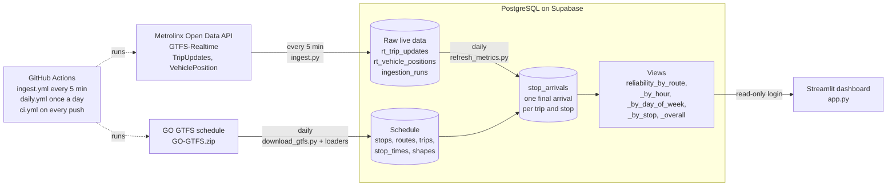

# GO Transit Reliability Tracker

How late do GO trains and buses really run? This project collects GO Transit's live trip data
every 5 minutes, compares each actual arrival with the published schedule in PostgreSQL, and
shows on-time rates and delays by route, hour, day and stop on a public Streamlit dashboard.
It runs on its own: GitHub Actions does the collecting and the daily refresh, and the data lives
in a cloud PostgreSQL database on Supabase.

**Live dashboard:** link added once it is deployed on Streamlit Community Cloud.

**Status:** the pipeline, metrics, tests and dashboard are built. Live collection starts as soon as
the Metrolinx Open Data API key is approved (requested 2026-11-18).

## Architecture



1. **Collect.** `ingest.py` downloads the TripUpdates and VehiclePosition feeds (protobuf), parses
   them with `gtfs-realtime-bindings`, and stores each distinct prediction once. Every run is logged in
   `ingestion_runs`, and a failed feed makes the GitHub Actions run fail visibly.
2. **Schedule.** Once a day `download_gtfs.py` fetches GO's current schedule, and the loaders keep a
   window from 3 days ago to 14 days ahead, which keeps the database well inside Supabase's 500 MB.
3. **Match.** `refresh_metrics.py` takes the last update seen for each trip and stop, joins it to the
   scheduled time in `stop_times` (including trips that run past midnight), and stores the result in
   `stop_arrivals`. Raw data older than 30 days is then deleted, but only once it is summarized.
4. **Summarize.** SQL views compute the on-time rate, average delay and 90th-percentile delay by route,
   hour of day, day of week and stop.
5. **Show.** The Streamlit app reads the views through a read-only database login. Its Reliability tab
   shows the overall on-time rate, best and worst routes, delay by hour and a map of stops coloured by
   delay. The original schedule tabs (departures with trip maps, routes at a stop, trips per route,
   map of stops) are still there.

## How the metrics are defined

| Term | Definition |
|---|---|
| Delay | Observed arrival minus scheduled arrival, in minutes (negative = early) |
| On time | Between 1 minute early and 5 minutes late (configurable in `reliability_settings`) |
| Observed arrival | The arrival in the last update seen for that trip and stop |
| Skipped stops, cancelled trips | Counted separately and left out of the delay averages |

Times past midnight are handled with the GTFS rule that schedule times count from the start of the
service day: `24:35:00` on November 25 is 00:35 on November 26. The full definitions, and the edge
cases the tests cover, are in [docs/metrics.md](docs/metrics.md).

## Tech Stack

| Layer | Technology |
|---|---|
| Ingestion | Python, GTFS-Realtime (protobuf, `gtfs-realtime-bindings`), Metrolinx Open Data API |
| Storage | PostgreSQL 17 on Supabase |
| Transformation | SQL: upserts, `DISTINCT ON`, CTEs, views, `PERCENTILE_CONT` |
| Orchestration | GitHub Actions scheduled workflows |
| Dashboard | Streamlit, pydeck, Streamlit Community Cloud |
| CI | GitHub Actions, pytest, PostgreSQL service container |

## Design decisions

- **A rolling schedule window.** The full 60-day schedule took 284 MB of Supabase's 500 MB. Keeping
  3 days back to 14 days ahead, reloaded daily, brought the database to 188 MB and keeps live trips
  matchable, since GO's trip_ids contain the service date. See [docs/decisions.md](docs/decisions.md).
- **Each live prediction is stored once.** The feed repeats the same predictions every 5 minutes. A
  unique key on the prediction plus `ON CONFLICT ... DO UPDATE SET last_seen_at` stores a repeat as a
  timestamp update, not a new row, and makes re-running a snapshot harmless.
- **Summarize before deleting.** `stop_arrivals` is built from the raw data while the schedule for
  those days is still loaded, so the metrics survive after both are cleaned up.
- **IDs are stored as `TEXT`** so stop IDs such as `00194` keep their leading zeros.
- **Times are stored as `INTERVAL`**, because GTFS times go past 24:00 (the latest is `28:10:00`).
- **Bulk loading.** `stop_times` is loaded in batches of 50,000 rows with `executemany`, and shapes
  and live rows are streamed with PostgreSQL `COPY`.
- **One transaction per load**, so a failed load never leaves a table half filled.
- **Secrets stay out of the code.** Keys and connection strings live in `.env` locally and in GitHub
  Actions and Streamlit secrets. The public dashboard uses a separate read-only database login.

## Project structure

| File | Purpose |
|---|---|
| `ingest.py` | Fetches the live feeds, stores new rows, logs each run |
| `realtime_parse.py` | Turns GTFS-Realtime feeds into rows (no network or database) |
| `refresh_metrics.py` | Daily: matches live arrivals to the schedule, cleans up old raw data |
| `download_gtfs.py` | Downloads GO's current schedule into `data/` |
| `load_stops_routes.py`, `load_trips_times.py`, `load_shapes.py` | Load the schedule (date window) |
| `schema.sql`, `rt_schema.sql`, `metrics_schema.sql`, `indexes.sql` | Schedule tables, live tables, metrics tables and views, indexes |
| `run_sql.py` | Runs a `.sql` file against the database in `.env` |
| `measure_size.py` | Prints the database and table sizes |
| `create_dashboard_role.py` | Creates the dashboard's read-only login |
| `db.py`, `queries.py`, `app.py` | Database connection, dashboard queries, Streamlit app |
| `tests/` | pytest tests for parsing, idempotent storage and the arrival matching |
| `.github/workflows/` | `ingest.yml` (every 5 min), `daily.yml` (daily), `ci.yml` (tests) |
| `docs/` | Setup, metric definitions, decisions and measured results |
| `queries.sql`, `explore_gtfs.py` | Phase 1: the first SQL questions and data exploration |

## How to run it

You need Python 3.12 and a PostgreSQL database (a free Supabase project works).

1. Install the packages:
   ```
   python -m venv .venv
   .venv\Scripts\activate
   pip install -r requirements.txt
   ```
2. Copy `.env.example` to `.env` and fill in `DATABASE_URL` (and `METROLINX_API_KEY` for live data).
3. Create the tables and load the schedule:
   ```
   python run_sql.py schema.sql
   python run_sql.py rt_schema.sql
   python run_sql.py metrics_schema.sql
   python download_gtfs.py
   python load_stops_routes.py
   python load_trips_times.py
   python load_shapes.py
   python run_sql.py indexes.sql
   ```
4. Collect live data once, and summarize it:
   ```
   python ingest.py
   python refresh_metrics.py
   ```
5. Start the dashboard with `streamlit run app.py`, and run the tests with `python -m pytest`.

To run it automatically, add the GitHub Actions secrets and deploy the app as described in
[docs/setup.md](docs/setup.md).

## Phase 1: the schedule

The project started as a static-schedule explorer. Loading the full Phase 1 feed (2026-09-29 to
2026-11-27) into local PostgreSQL gave 888 stops, 45 routes, 99,689 trips, 1,667,673 stop times and
446,142 shape points. `queries.sql` answers three questions with joins:

| Question | Answer |
|---|---|
| Which Milton line trains leave Milton GO on weekday mornings? | 10 trains on a regular weekday, 06:00 to 08:30, all towards Union Station (none on Thanksgiving, Oct 12) |
| Which routes serve Sheridan College (stop `00939`)? | Bus routes 22 Milton / Oakville and 56 Oshawa / Oakville |
| How many trips does each route run? | The busiest was route 41 Hamilton / Pickering with 6,192 trips |

## Limitations

- GitHub may start scheduled runs late or skip some at busy times, so the 5-minute collection has gaps.
  The final arrival for a stop is the last update seen before the train got there.
- Metrics depend on what GO's live feed reports; stops the feed never mentions are not counted.
- The schedule window is 17 days, so the Departures tab can only look two weeks ahead.
